 

**CSE student at Vardhaman College of Engineering, Hyderabad.** 
I build full-stack apps, AI agents and vision-language pipelines, with security in mind.

 

## ▸ Skills

<table>
<tr>
<td width="170"><b>Languages</b></td>
<td></td>
</tr>
<tr>
<td><b>AI / ML</b></td>
<td>

 

</td>
</tr>
<tr>
<td><b>LLM apps & agents</b></td>
<td>

</td>
</tr>
<tr>
<td><b>Frontend</b></td>
<td> 

</td>
</tr>
<tr>
<td><b>Backend & data</b></td>
<td>
</td>
</tr>
<tr>
<td><b>DevOps & tools</b></td>
<td></td>
</tr>
</table>

 

## ▸ AI & ML work

- **🛰️ SatQuery AI** *(Smart India Hackathon)*: natural-language querying of satellite imagery. A router agent sorts each question into visual QA, region grounding, optical + SAR fusion or bi-temporal change detection and sends it to the matching model. I fine-tuned vision-language models with QLoRA on remote-sensing data, ran Florence-2 for text-to-bounding-box grounding, and built the GeoTIFF preprocessing, ViT encoding and PDF report pipeline. *PyTorch · Transformers · FastAPI · Ollama*
- **⚡ QuizArena**: an LLM pipeline that chunks PDFs, slides and Word files (with OCR for scanned pages), extracts topics and generates quizzes grounded strictly in the document, run through an async job queue. *FastAPI · PostgreSQL · Tesseract*
- **🎓 AcademiMatch**: a LangGraph agent that matches students with faculty using hybrid RAG over ChromaDB, live paper search, research-gap analysis and human-in-the-loop email approval. *LangGraph · LangChain · OpenAI*
- **🧠 EMOS**: turns meeting transcripts into searchable decisions and tracked commitments with LLM extraction. *FastAPI · Next.js · Docker*
- **🚲 CycloScan**: a road-damage intelligence platform where field devices stream reports into a live monitoring console. *Node.js · PostgreSQL*

 

## ▸ Things I've built

| | Project | What it does | Stack |
|:-:|:--|:--|:--|
| ⚡ | [**QuizArena**](https://quizarena-neon-eta.vercel.app) | Turns any PDF or slide deck into a live multiplayer quiz with PINs, QR codes and leaderboards | Next.js · FastAPI · Socket.IO · PostgreSQL |
| 💬 | [**ZetaChat**](https://github.com/SaiArnav/ZetaChat) | Terminal-first messaging client for Telegram and WhatsApp | Go · Bubble Tea · SQLite |
| 📈 | [**MarketAutopsy**](https://github.com/SaiArnav/Market-Autopsy) | AI market intelligence that monitors companies from public signals | Next.js · Prisma · PostgreSQL · Three.js |
| 🧠 | [**EMOS**](https://github.com/SaiArnav/EMOS-Project) | Enterprise memory OS that turns meetings into searchable decisions and tasks | Next.js · FastAPI · Docker |
| 🎓 | [**AcademiMatch-CLI**](https://github.com/SaiArnav/AI_Agent) | RAG chatbot that matches students with faculty research | LangGraph · LangChain · ChromaDB |
| 📝 | [**FormForge**](https://github.com/SaiArnav/FormForge) | Drag-and-drop form builder with exports and analytics | Next.js · Prisma · Zod |
| ✅ | [**TaskFlow**](https://github.com/SaiArnav/TaskFlow_Java_CEP) | Desktop task manager with a Swing UI | Java · Swing |
| 📚 | [**Library Management System**](https://github.com/SaiArnav/library-management-system) | Menu-driven library system with issue/return, fines, search and recommendations | C · Data Structures |

 

